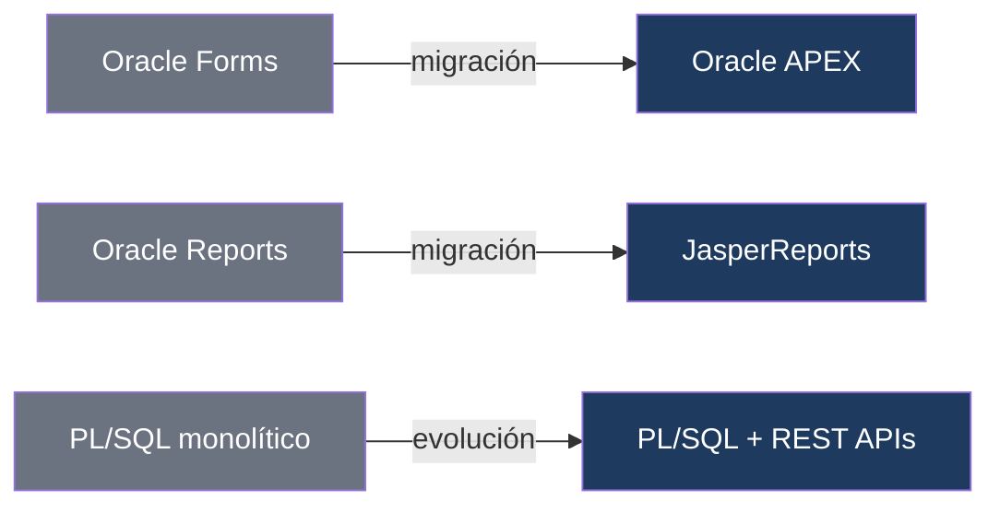
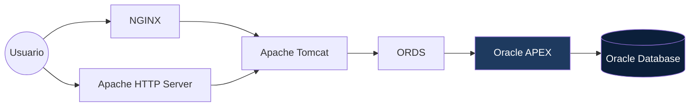

<div align="center">


### Desarrollador de aplicaciones empresariales en el ecosistema Oracle

<p>
  <a href="https://www.linkedin.com/in/osvaldogonzalezpy/"></a>
  <a href="https://osvaldogonzalezpy.hashnode.dev"></a>
  
</p>

</div>

---

### 👨‍💻 Sobre mí

Desarrollo y modernizo **aplicaciones empresariales** sobre el stack Oracle. Mi especialidad es **Oracle APEX, Oracle Database y PL/SQL**, complementada con integración de servicios REST, reporting con JasperReports y la infraestructura que sostiene todo en producción.

Mi objetivo es convertir necesidades de negocio en soluciones **eficientes, seguras y fáciles de mantener**.

```yaml
enfoque:     Aplicaciones empresariales · Modernización de sistemas legacy
core:        Oracle APEX · Oracle Database · PL/SQL · ORDS
integración: REST APIs · JSON · APEX_WEB_SERVICE · Web Services
reporting:   JasperReports
infra:       Linux · NGINX · Apache Tomcat · Git
```

---

### 🛠️ Stack tecnológico

<div align="center">

<table>
  <tr>
    <td align="center" width="110"><br/><sub><b>Oracle APEX</b></sub></td>
    <td align="center" width="110"><br/><sub><b>Oracle DB · PL/SQL</b></sub></td>
    <td align="center" width="110"><br/><sub><b>PostgreSQL</b></sub></td>
    <td align="center" width="110"><br/><sub><b>MySQL</b></sub></td>
    <td align="center" width="110"><br/><sub><b>Java</b></sub></td>
    <td align="center" width="110"><br/><sub><b>JavaScript</b></sub></td>
  </tr>
  <tr>
    <td align="center" width="110"><br/><sub><b>HTML5</b></sub></td>
    <td align="center" width="110"><br/><sub><b>CSS3</b></sub></td>
    <td align="center" width="110"><br/><sub><b>Linux</b></sub></td>
    <td align="center" width="110"><br/><sub><b>NGINX</b></sub></td>
    <td align="center" width="110"><br/><sub><b>Apache Tomcat</b></sub></td>
    <td align="center" width="110"><br/><sub><b>Git</b></sub></td>
  </tr>
</table>

</div>

<div align="center">
<p><b>Detalle por categoría</b></p>

<table align="center">
  <tr><th align="left">Categoría</th><th align="left">Tecnologías</th></tr>
  <tr><td>🔵 <b>Desarrollo</b></td><td>Oracle APEX · PL/SQL · JavaScript · Java · HTML · CSS</td></tr>
  <tr><td>🔵 <b>Bases de datos</b></td><td>Oracle Database · PostgreSQL · MySQL · SQL</td></tr>
  <tr><td>🔵 <b>Integración & APIs</b></td><td>ORDS · REST APIs · JSON · Web Services · APEX_WEB_SERVICE</td></tr>
  <tr><td>🔵 <b>Infraestructura</b></td><td>Linux · NGINX · Apache Tomcat · Git</td></tr>
  <tr><td>🔵 <b>Reporting</b></td><td>JasperReports</td></tr>
</table>

</div>

---

### 🏗️ Áreas de especialización

<table align="center" width="100%">
<tr>
<td width="50%" valign="top">

#### 🔵 Desarrollo con Oracle APEX

- Interactive Reports e Interactive Grids
- Dynamic Actions y JavaScript
- Validaciones y procesos en PL/SQL
- REST Data Sources
- Seguridad, autenticación y control de acceso

</td>
<td width="50%" valign="top">

#### 🔵 Integración de sistemas

- Consumo y publicación de REST APIs
- Servicios con ORDS
- `APEX_WEB_SERVICE` y procesamiento JSON
- Integración con servicios externos
- Procesamiento y transformación de datos

</td>
</tr>
<tr>
<td width="50%" valign="top">

#### 🔵 Reporting

- Integración de aplicaciones con **JasperReports**
- Generación de documentos y reportes
- Migración de reportes desde plataformas legacy

</td>
<td width="50%" valign="top">

#### 🔵 Infraestructura

- Configuración del stack de despliegue de APEX
- Servidores Linux, NGINX y Tomcat
- Comprensión de la aplicación de punta a punta

</td>
</tr>
</table>

---

### 🔄 Modernización de sistemas legacy

Uno de mis principales intereses es la evolución de aplicaciones **legacy** construidas con tecnologías Oracle. El objetivo no es solo migrar, sino **mejorar la arquitectura, la mantenibilidad y la experiencia de usuario**.



#### Arquitectura con la que trabajo

El servidor web de entrada (**NGINX** o **Apache HTTP Server**) se elige según las necesidades y requerimientos de cada proyecto.



---

### 📖 Compartiendo conocimiento

Documento lo que aprendo y comparto experiencias sobre **Oracle APEX, bases de datos y desarrollo de software** en mi blog.

<div align="center">

<a href="https://osvaldogonzalezpy.hashnode.dev"></a>

</div>

---

### 🤝 Conectemos

Estoy abierto a **colaboraciones, intercambio de conocimientos y nuevas oportunidades profesionales** en desarrollo de software y tecnologías empresariales. ¡No dudes en escribirme!

<div align="center">

<a href="https://www.linkedin.com/in/osvaldogonzalezpy/"></a>

<br/><br/>

<i>💻 Always learning · Always building · Always improving</i>


</div>
